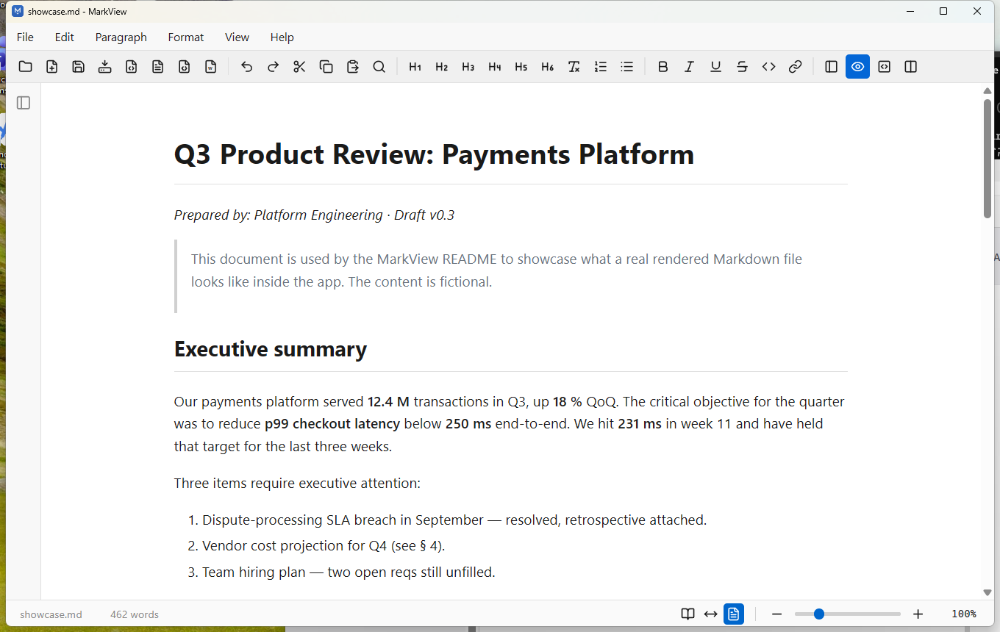
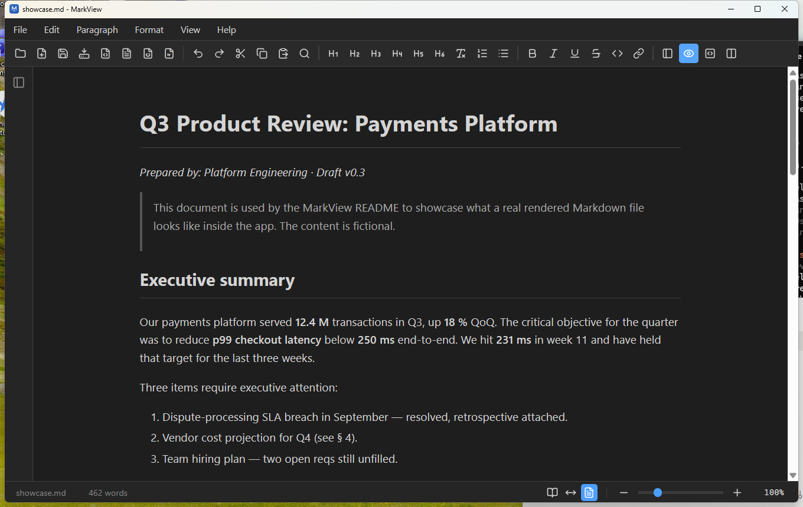
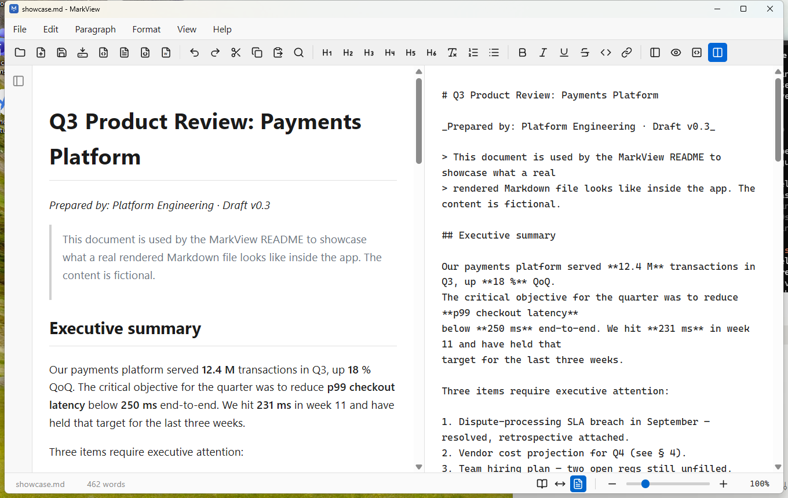
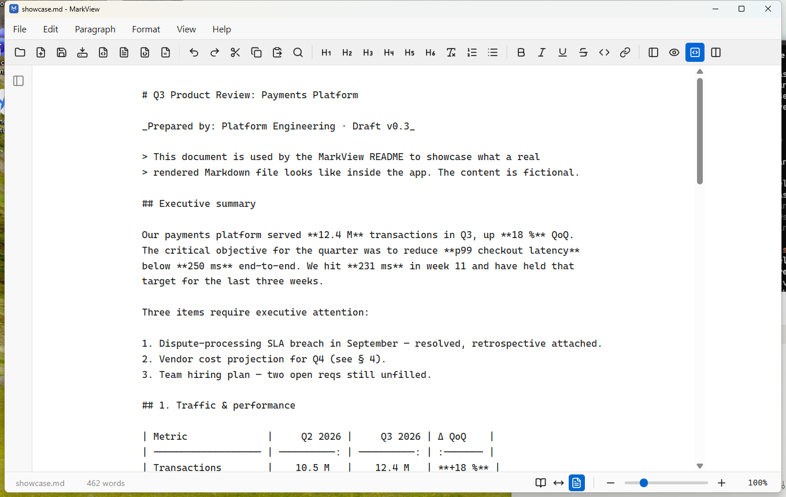

<div align="center">

# Markview

### The Markdown editor that fits in a single `.exe`.

**Open. Edit. Export. Done.**
No installer. No account. No telemetry. No internet needed.

[](https://github.com/agunawijaya/markview/releases/latest)
[](https://github.com/agunawijaya/markview/releases)
[](LICENSE)
[](https://tauri.app/)
[](#requirements)
[](#android-phones--tablets)

**[⬇  Download Markview.exe](https://github.com/agunawijaya/markview/releases/latest)** &nbsp;·&nbsp; **[📖  Product Spec](PRODUCT_SPEC.md)** &nbsp;·&nbsp; **[🏗️  Architecture](ARCHITECTURE.md)** &nbsp;·&nbsp; **[📝  Changelog](CHANGELOG.md)**

</div>

---

## Why Markview?

Every other Markdown app asks you to install something, sign in somewhere, or
trust a browser tab with your notes.

**Markview is a single `.exe`.** Drop it anywhere — Desktop, USB stick,
network share — double-click, and you're editing Markdown with a WYSIWYG
renderer, three view modes, and Word-quality DOCX export. That's it. No
background service. No update pings. No account.

|  | Markview | Typical Electron editor | Web-based editor |
| --- | :---: | :---: | :---: |
| Single portable `.exe` | ✅ | ❌ (installer + `%AppData%`) | ❌ (browser tab) |
| Runs offline forever | ✅ | ⚠️ (some phone home) | ❌ |
| Zero telemetry | ✅ | ⚠️ (varies) | ❌ |
| Ships under ~20 MB | ✅ | ❌ (100 MB+) | n/a |
| WYSIWYG **and** raw source | ✅ | ⚠️ (usually one or the other) | ⚠️ |
| DOCX export with Word-style typography | ✅ | ❌ | ❌ |
| Bundled Mermaid + LaTeX math + syntax highlighting | ✅ | ⚠️ (extension marketplace) | ⚠️ (CDN) |
| No install rights required | ✅ | ❌ | n/a |

---

## What you get

### Three view modes, one keystroke away

- **Rendered** (`Ctrl+1`) — WYSIWYG. Type in the rendered preview; Markview
  round-trips your edits back to Markdown automatically.
- **Code** (`Ctrl+2`) — raw Markdown textarea. Format buttons wrap
  _and_ unwrap the selection.
- **Split** (`Ctrl+3`) — live preview + editable source, side by side.

### The exports that actually matter

- **HTML** — self-contained. Every stylesheet inlined. Mermaid stays
  interactive even offline.
- **PDF** — via the OS print dialog. Chrome-free (menu, toolbar, sidebar
  hidden). Save as PDF works out of the box.
- **DOCX (Markdown Style)** — matches the app's HTML look. Bordered
  headings, monospace code blocks, striped tables.
- **DOCX (Word Style)** — Calibri Light headings, accent-blue H1/H2,
  italic H4. Looks native inside Word. Hand it to a stakeholder without
  apology.

### Everything the rendered doc needs

- **GitHub-flavored Markdown** — tables, task lists, autolinks, strikethrough.
- **Syntax highlighting** for fenced code blocks (highlight.js).
- **Mermaid diagrams** rendered as SVG. Hover to copy source, copy as PNG,
  or edit inline.
- **LaTeX math** via bundled KaTeX — `$x^2+y^2=r^2$` inline, `$$…$$` for
  display equations. Exports as **native Word math (OMML)** in DOCX,
  self-contained (fonts embedded) in HTML.
- **Live reload** — external edits (git pull, your favorite editor) trigger
  a silent re-render.

### Reading made comfortable

- **Reading Width** presets — Optimal (65ch), Fit to Width, Default (860 px).
- **Zoom** 50 – 300 %: slider, `Ctrl+=` / `Ctrl+-` / `Ctrl+0`, or
  `Ctrl+MouseWheel`.
- **Dark mode** with `Ctrl+Shift+D`. Mermaid theme swaps too.
- **Outline sidebar** with click-to-scroll and active-heading highlight.

### Editor niceties

- Word-style **top toolbar** with a `»` overflow chevron that collapses
  groups rightmost-first on narrow windows.
- **Find & Replace** (`Ctrl+H`) with match counter and prev / next.
- **Right-click context menu** on editable surfaces — formatting, headings,
  insert table / mermaid / code block.
- **Multi-window** (`File → New Window`). Each file is its own window; no
  tab clutter.
- **Drag-and-drop** any `.md` onto the window to open it.

---

## Download

<div align="center">

### [⬇  Download the latest Markview.exe](https://github.com/agunawijaya/markview/releases/latest)

_No install. No admin rights. Just download and run._

</div>

Two builds are attached to every release:

| Build | For you if... |
| --- | --- |
| **Markview-vX.Y.Z-portable.exe** | You want a single file. Put it on a USB, on a network share, or in your `Downloads` folder. Runs from wherever you drop it. |
| **Markview_X.Y.Z_x64-setup.exe** | You want Start Menu integration and file-association prompts. Standard NSIS installer. |

On a phone or tablet? See [Android](#android-phones--tablets).

---

## Requirements

- **Windows 10 or 11** (Windows 11 recommended)
- **WebView2 Runtime** — preinstalled on Windows 11; free download from
  [Microsoft](https://developer.microsoft.com/microsoft-edge/webview2/) for
  Windows 10.
- No admin rights required for the portable `.exe`.

---

## Screenshots

<div align="center">

**Rendered view — light mode**



**Rendered view — dark mode** (`Ctrl+Shift+D`)



**Split view** (`Ctrl+3`) — live preview + editable source, side by side



**Code view** (`Ctrl+2`) — raw Markdown editor with toggling format markers



</div>

_Screenshots are captured with `scripts/screenshot.ps1` against
`design-assets/showcase.md` — see [CONTRIBUTING.md](CONTRIBUTING.md) if
you want to regenerate them._

---

## Keyboard shortcuts

<details>
<summary><b>File & window</b></summary>

| Action | Shortcut |
| --- | --- |
| New | `Ctrl+N` |
| Open | `Ctrl+O` |
| Save | `Ctrl+S` |
| Save As | `Ctrl+Shift+S` |
| Reload from disk | `Ctrl+R` |
| Quit | `Ctrl+Q` |

</details>

<details>
<summary><b>Editing</b></summary>

| Action | Shortcut |
| --- | --- |
| Undo | `Ctrl+Z` |
| Redo | `Ctrl+Shift+Z` |
| Bold | `Ctrl+B` |
| Italic | `Ctrl+I` |
| Underline | `Ctrl+U` |
| Find & Replace | `Ctrl+H` |

</details>

<details>
<summary><b>View</b></summary>

| Action | Shortcut |
| --- | --- |
| Rendered view | `Ctrl+1` |
| Code view | `Ctrl+2` |
| Split view | `Ctrl+3` |
| Zoom in / out / reset | `Ctrl+=` / `Ctrl+-` / `Ctrl+0` |
| Toggle sidebar | `Ctrl+\` |
| Toggle dark mode | `Ctrl+Shift+D` |

</details>

---

## Build from source

Prerequisites:

- [Rust](https://www.rust-lang.org/tools/install) (stable, `rustc >= 1.77.2`)
- [Node.js](https://nodejs.org/) 18+
- [Visual Studio Build Tools](https://visualstudio.microsoft.com/visual-cpp-build-tools/) with the C++ workload
- [WebView2 Runtime](https://developer.microsoft.com/microsoft-edge/webview2/) (preinstalled on Windows 11)

```powershell
git clone https://github.com/agunawijaya/markview.git
cd markview
npm install

npm run dev          # dev mode
npm run build        # release build + copies Markview.exe to project root
```

After `npm run build`, the outputs are:

- `Markview.exe` — portable, at the **project root** (copied by
  `scripts/copy-portable.mjs`)
- `src-tauri/target/release/bundle/nsis/Markview_*.exe` — NSIS installer

The root `Markview.exe` is gitignored — it exists so you can hand it to
someone directly.

---

## Project docs

- **[PRODUCT_SPEC.md](PRODUCT_SPEC.md)** — what Markview does, for whom, and
  what it explicitly does not do.
- **[ARCHITECTURE.md](ARCHITECTURE.md)** — how the app is built, with
  diagrams of the frontend/backend split, view-mode state machine, render
  pipeline, export pipelines, and build/release flow.
- **[CHANGELOG.md](CHANGELOG.md)** — release history.
- **[CONTRIBUTING.md](CONTRIBUTING.md)** — dev setup, coding style, PR flow.
- **[SECURITY.md](SECURITY.md)** — vulnerability disclosure policy.
- **[CODE_OF_CONDUCT.md](CODE_OF_CONDUCT.md)** — Contributor Covenant 2.1.

---

## Android (phones & tablets)

The same app, built for Android 7.0+ (phones, tablets, foldables). It opens
documents **for reading first** — tapping the page scrolls and selects text
instead of popping up the keyboard — and everything else is one tap away.

### Install

Copy `Markview.apk` to the device (USB, Drive, chat — anything) and open
it. Android will ask once to allow installing apps from that source (Files,
Chrome, Drive, …). The same APK works on phones and tablets.

### Reading on a small screen

- **Open with Markview** — tap a `.md` file in any file manager, Drive,
  email or chat app. Or use **File → Open** / the **Open File** button.
- **Pinch to zoom** the text. It reflows to the screen instead of panning,
  and keeps your place in the document. The `−` / `+` buttons do the same.
- **Outline** — the list button at the bottom-left opens a heading drawer;
  tap a heading to jump there.
- **Dark mode** follows the system theme on first launch (View → Toggle
  Dark Mode to change).
- Wide tables, code blocks, diagrams and equations scroll sideways on their
  own; the page itself never does.
- Your last picked document reopens automatically if Android closed the app
  in the background.

### Editing

- Tap the **pencil** (toolbar, or View → Edit Mode) to edit in Rendered
  View. New documents start in Edit Mode.
- **Code** and **Split** views edit the Markdown source; Split stacks
  preview above source on phones.
- **Save** writes back to the opened file when the source app allows it,
  otherwise it falls back to **Save As**.
- **Export → PDF** opens the Android print dialog — choose
  *Save as PDF*. HTML and DOCX exports save through the system file picker.
- **Back** closes menus, dialogs and the outline first, then sends the app
  to the background (asking about unsaved changes).

Not on Android: multiple windows, drag-and-drop, Quit, live reload of
files changed by other apps, and relative image paths for documents opened
from the picker (Android doesn't grant access to the surrounding folder).

### Building the APK

One-time setup (paths are examples):

- Android SDK with `platforms;android-36`, `build-tools`, and an NDK
  (r27 tested) — `ANDROID_HOME` must point at the SDK; the NDK is found
  under `$ANDROID_HOME/ndk/` (or set `NDK_HOME`)
- JDK 17–21 in `JAVA_HOME` (Android Studio's bundled JBR works)
- Rust targets:
  `rustup target add aarch64-linux-android armv7-linux-androideabi x86_64-linux-android i686-linux-android`

```bash
npm run android:build        # release APK (arm64, armv7, x86_64) -> Markview.apk
npm run android:build:debug  # debug APK -> Markview-debug.apk
```

`scripts/android-build.mjs` wraps `tauri android build`. On Windows without
Developer Mode the Tauri CLI can't symlink the compiled Rust libraries into
the Android project, so the script copies them and runs Gradle itself.
(`npx tauri android dev` has no such fallback — it needs Developer Mode on
Windows.)

Release signing reads `src-tauri/gen/android/keystore.properties`
(gitignored) — see the comment at the top of
`src-tauri/gen/android/app/build.gradle.kts`. Without it the release APK is
unsigned and Android won't install it. Keep the keystore safe: updates must
be signed with the same key, or users have to uninstall first.

---

## Roadmap: Linux port

The Tauri 2 stack was chosen specifically because the same Rust + HTML/CSS/JS
codebase can target Linux desktops and Android with minimal changes.

### Linux desktop

Required on a Linux dev machine:

- `webkit2gtk-4.1-dev`, `libgtk-3-dev`, `libayatana-appindicator3-dev`,
  `librsvg2-dev`, `libssl-dev`, `build-essential`, `curl`, `wget`, `file`
- Rust toolchain (same as Windows)
- Node.js 18+

Build with:

```bash
npx tauri build
```

`tauri.conf.json > bundle.targets` will need `"deb"`, `"appimage"`, and/or
`"rpm"` added alongside the current `"nsis"`. The existing app code, menu,
file dialog, and watcher API are already cross-platform — no frontend
changes expected.

### iOS

Not currently planned, but the same Tauri mobile pipeline (`npx tauri ios init` /
`build`) applies. Requires a Mac with Xcode. The `src-tauri/icons/ios/`
assets are already in place.

---

## Contributing

Markview is open to contributions — bug reports, feature ideas, PRs.
Please read [CONTRIBUTING.md](CONTRIBUTING.md) and
[PRODUCT_SPEC.md § 7](PRODUCT_SPEC.md#7-what-we-deliberately-do-not-build)
before starting work.

Report security issues privately — see [SECURITY.md](SECURITY.md).

---

## License

MIT. See [LICENSE](LICENSE).

<div align="center">

Made with ⚙️ and Rust · [Report an issue](https://github.com/agunawijaya/markview/issues) · [Star on GitHub](https://github.com/agunawijaya/markview)

</div>
